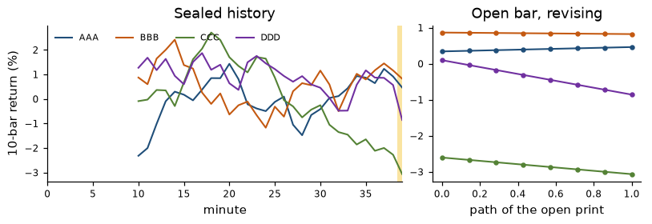

# factorflow

[](https://github.com/humdings/factorflow/actions/workflows/ci.yml)
[](LICENSE)
[](https://pypi.org/project/factorflow/)
[](https://humdings.github.io/factorflow/)

factorflow evaluates factor, filter, and classifier expressions on bars. The same pipeline
runs two ways, and the two ways agree:

- **Batch.** `BatchEngine` computes every row of a history in one pass. Use it for research and backtests.
- **Live.** `LiveEngine` keeps that history and recomputes only the **open bar**, the last row, which is still provisional. `revise()` updates that row. `seal()` closes it. A sealed row matches the batch result on the same inputs. A revision matches a batch run that treats the open bar as final.

Every live value carries an open/sealed flag (`Snapshot.is_open`, and an `is_open` column in frames).

Bars are either clock-time (one grid for every asset) or information-driven (tick, volume, or dollar bars, per asset). The library does not load data and does not talk to a broker. You pass a `Panel` or a trade stream.

Inspired by [Zipline's Pipeline](https://github.com/quantopian/zipline) API. This is an independent implementation.



API reference: <https://humdings.github.io/factorflow/> (published from `main` once GitHub Pages is enabled). The PyPI badge starts working when the package is published. Until then, install from a checkout or from git.

## Install

Python 3.11 or newer.

From a checkout, with pip:

```bash
pip install .
```

For tests and the notebook:

```bash
pip install -e ".[dev]"
pip install -e ".[notebook]"
```

With [uv](https://docs.astral.sh/uv/), which is what the Nix shell and CI use:

```bash
uv sync
uv run python examples/quickstart.py
```

With Nix, from the flake:

```bash
nix develop          # uv + Python, UV_PYTHON set
nix build            # the package
nix flake check      # build and tests, skipping tests marked slow
```

Another Nix project can take this flake as an input and use the overlay. `python3.pkgs.factorflow` is then on that package set:

```nix
inputs.factorflow.url = "github:humdings/factorflow";
nixpkgs.overlays = [ inputs.factorflow.overlays.default ];
```

The package version in this tree is 0.1.0. It is not on PyPI yet. Install from a checkout or from git:

```bash
pip install "factorflow @ git+https://github.com/humdings/factorflow.git"
```

## Quickstart

`examples/quickstart.py` is the listing below. It builds a seeded random walk, scores it, checks that the live engine matches batch, then builds volume bars and clock bars from a handful of trades. No data files.

```bash
python examples/quickstart.py
```

```python
"""Self-contained factorflow quickstart on synthetic data.

No market feed and no saved fixtures: prices are a seeded random walk, and the
clock comes from ``BarGrid``. Run from a checkout with the package installed:

    python examples/quickstart.py
"""

from __future__ import annotations

import numpy as np

import factorflow as ff

NS = 1_000_000_000


class RangePos(ff.Factor):
    """Where the latest value sits in its rolling high-low range, in ``[0, 1]``.

    A window with any missing input, or a zero range, is missing (NaN).
    ``compute`` receives ``(T_in, N)`` blocks and returns ``T_in - window + 1`` rows.
    Batch calls it on the whole history. Live calls it on exactly ``window`` rows
    and reads row 0, so both paths run this function.
    """

    def __init__(self, source: ff.Factor, window: int):
        if window < 2:
            raise ValueError("window must be >= 2")
        self.inputs = (source,)
        self.window = int(window)
        self.params = (self.window,)

    def compute(self, blocks, prev=None):
        x = np.asarray(blocks[0], dtype=np.float64)
        w = self.window
        out = np.empty((x.shape[0] - w + 1, x.shape[1]), dtype=np.float64)
        for i in range(out.shape[0]):
            window = x[i : i + w]
            lo = np.min(window, axis=0)
            hi = np.max(window, axis=0)
            span = hi - lo
            with np.errstate(invalid="ignore", divide="ignore"):
                pos = (window[-1] - lo) / span
            missing = np.isnan(window).any(axis=0) | (span == 0)
            out[i] = np.where(missing, np.nan, pos)
        return out


def main() -> None:
    rng = np.random.default_rng(0)
    assets = ("AAA", "BBB", "CCC", "DDD")
    n_bars, n = 40, len(assets)

    # 24/7 one-minute bars. grace=0 seals a bar as soon as time reaches its end.
    # "5min", "1h" and "1d" are the same idea; "XNYS" uses the exchange calendar.
    grid = ff.BarGrid("24/7", "1min", grace=0)
    starts, ends = grid.bars("2026-01-05", "2026-01-05")
    starts, ends = starts[:n_bars], ends[:n_bars]

    shock = rng.normal(0, 0.004, size=(n_bars, n))
    close = 100 * np.exp(np.cumsum(shock, axis=0))
    volume = rng.integers(50, 500, size=(n_bars, n)).astype(np.float64)
    sector = np.tile(np.array([0, 0, 1, 1], dtype=np.int64), (n_bars, 1))
    panel = ff.Panel(ends, assets, {"close": close, "volume": volume, "sector": sector}, starts)

    close_t = ff.Column("close")
    volume_t = ff.Column("volume")
    sector_t = ff.Column("sector", ff.Classifier)
    ret = close_t.pct_change(1)
    universe = (close_t * volume_t).rolling_mean(10).top(3)
    score = close_t.pct_change(10).zscore(groupby=sector_t, mask=universe)
    pipe = ff.Pipeline({"score": score, "ret": ret, "range_pos": RangePos(close_t, 10)}, screen=universe)

    batch = ff.BatchEngine().run(pipe, panel)
    print(batch.frame().tail(4))

    # Warm the live engine on every sealed bar but the last, then revise that open bar.
    live = ff.LiveEngine(pipe, panel.head(n_bars - 1), grid)
    last = n_bars - 1
    live.set_open("close", close[last])
    live.set_open("volume", volume[last])
    live.set_open("sector", sector[last])
    snap = live.revise()
    assert snap.is_open
    sealed = live.seal()
    assert sealed.is_open is False
    for name in ("score", "ret", "range_pos"):
        np.testing.assert_array_equal(sealed.values[name], batch.values[name][last])
    print("sealed live row matches batch, including the custom factor")

    # Information-driven bars. Twelve trades of 10 shares close a bar every 30 shares.
    ts = np.arange(12) * NS
    price = 100 + np.arange(12, dtype=np.float64)
    size = np.full(12, 10.0)
    bars, open_bar = ff.build_event_bars(ts, price, size, "volume", ff.Fixed(30))
    assert len(bars) == 4 and open_bar is None
    print(f"volume bars: {len(bars)} sealed, no open bar")

    # Clock bars from a few trades. Empty minutes carry the previous close forward.
    base = int(starts[0])
    trade_ts = np.array([base + NS, base + 20 * NS, base + 5 * NS])
    order = np.argsort(trade_ts)
    trades = ff.Trades(
        asset=np.array([0, 0, 1])[order],
        ts=trade_ts[order],
        price=np.array([10.0, 12.0, 20.0])[order],
        size=np.array([5.0, 1.0, 4.0])[order],
    )
    built = ff.build_time_bars(trades, ("AAA", "BBB"), starts[:3], ends[:3])
    np.testing.assert_array_equal(built.columns["close"][:, 0], [12.0, 12.0, 12.0])
    np.testing.assert_array_equal(built.columns["volume"][:, 0], [6.0, 0.0, 0.0])
    print("clock bars: first minute traded, later minutes forward-filled the close")

    xnys = ff.BarGrid("XNYS", "1min")
    early = xnys.bars("2026-11-27", "2026-11-27")[1]
    regular = xnys.bars("2026-11-30", "2026-11-30")[1]
    holiday = xnys.bars("2026-11-26", "2026-11-26")[1]
    print(f"XNYS 1min bars: early close {len(early)}, regular session {len(regular)}, holiday {len(holiday)}")


if __name__ == "__main__":
    main()
```

The run ends with:

```text
sealed live row matches batch, including the custom factor
volume bars: 4 sealed, no open bar
clock bars: first minute traded, later minutes forward-filled the close
XNYS 1min bars: early close 210, regular session 390, holiday 0
```

`2026-11-26` is Thanksgiving (no session). `2026-11-27` is an early close, 210 minute bars instead of 390.

## Concepts

### Panels, columns, pipelines

A `Panel` is a dense time-by-asset block. `times` are bar-end timestamps in nanoseconds UTC. `columns` maps a name to a `(T, N)` array. `Panel.from_frame` builds one from a long polars frame with `ts` and `asset` columns.

`Column("close")` reads a float column. `Column("sector", Classifier)` reads integer group codes (`-1` is missing). `BarData` is the columns a bar builder fills: `open`, `high`, `low`, `close`, `volume`, `dollar`, `n_ticks`, and the filter `has_trade`.

Factors support arithmetic and comparisons. Comparisons produce filters. Useful built-ins include `shift`, `delta`, `pct_change`, `rolling_sum`, `rolling_mean`, `rolling_std`, `rolling_min`, `rolling_max`, `ts_rank`, `rolling_cov`, `rolling_corr`, `rolling_beta`, `ewm_mean`, `rank`, `zscore`, `demean`, `top`, and `bottom`. `rank`, `zscore`, and `demean` take `mask=` and `groupby=`. `where(condition, a, b)` is the conditional.

A `Pipeline` names the outputs and may set a `screen` filter. `BatchEngine().run(pipeline, panel)` returns a `BatchResult`. `result.frame()` is a long polars frame of the rows that pass the screen. `result.values` still holds the full `(T, N)` arrays.

Windows that contain a missing value yield a missing value. That matches the usual Pipeline rule.

### Batch and live

`LiveEngine(pipeline, history, grid)` warms from `history`, which should already be sealed bars, and opens the next bar on `grid`.

- `tick(asset, ts, price, size)` folds a trade into the open bar. With a grid, it first seals any bar whose end plus grace is at or before `ts`.
- `set_bar(...)` replaces one asset's open OHLCV, for when a data source already publishes the in-progress bar.
- `set_open(column, values)` sets a column that is not a bar field (a sector code, a signal) on the open row.
- `revise()` recomputes the open row and returns a `Snapshot` with `is_open=True`. It does not commit state.
- `seal()` commits the open row and starts the next one. Missing assets carry the previous close forward and set volume to zero.
- `advance(now)` seals every bar with `end + grace <= now`, including empty bars.

Pass callables in `observers`. They are called with each snapshot whose outputs changed.

Without a grid, the caller decides when a bar ends and calls `seal(ts)`. That is how event bars drive a pipeline.

Each kernel is one function of a window of rows. Batch calls it on the whole history. Live calls it on the last `window` rows and keeps row 0. Both run the same arithmetic in the same order, which is why sealed rows match.

### Custom factors

Subclass `Factor` (or `Filter`, or `Classifier`). Set `inputs`, `window`, and `params`, and implement `compute(blocks, prev=None)`. `blocks[i]` has shape `(T_in, N)`. Return an array of shape `(T_in - window + 1, N)`. `RangePos` in the quickstart is a complete example.

`params` is part of the term's identity, so two windows of the same class are not collapsed into one node. `columnwise = True` (the default) means output column `j` depends only on input column `j`. Set `columnwise = False` for a term that mixes assets, and set `rowwise = True` if you implement `compute_row` instead of a whole-window `compute`.

### Bar sizes

A clock grid is a calendar times a frequency:

| Construction | What you get |
|---|---|
| `BarGrid("XNYS", "1d")` | One bar per regular session. Grace defaults to 0. The last bar of a session ends at the close, so early closes are shorter days. |
| `BarGrid("XNYS", "1min")` | Regular-session minutes, 390 on a full day. Grace defaults to 2 seconds. |
| `BarGrid("XNYS", "5min")`, `"1h"`, `"30s"` | The same calendar, other frequencies. `parse_freq` accepts `s`, `min`, `h`, and `d`. |
| `BarGrid("24/7", "1min")` | A continuous UTC clock, including weekends. `"247"`, `"ALWAYS_OPEN"`, and `"CRYPTO"` are the same calendar. |

`grid.bars(start, end)` returns `(starts, ends)` in nanoseconds UTC for every session date from `start` through `end`. Bars are half-open `[start, end)` and labeled by `end`. A trade at `ts` belongs to the first bar with `end > ts`.

`build_time_bars(trades, assets, starts, ends)` aggregates a `Trades` stream (parallel arrays, sorted by timestamp) onto those bars. An empty bar repeats the previous close and stores zero volume. Before an asset's first trade the close is missing.

Information-driven bars close when a measure reaches a threshold. The measure is `1` (tick), `size` (volume), or `price * size` (dollar).

```python
ff.build_event_bars(
    ts, price, size, "dollar", ff.AdaptiveDaily(bars_per_day=50, lookback_days=20, initial=1_000_000)
)
```

`Fixed(value)` holds the threshold constant. `AdaptiveDaily` sets each day's threshold from the mean daily measure over the previous `lookback_days` completed days, divided by `bars_per_day`. Days with no trades are skipped, and the threshold does not use the current day's volume. Until enough days exist, `initial` is the threshold.

`overshoot="close"` (the default) puts the whole crossing trade in the bar it completes, so the measure can exceed the threshold by less than one trade. `overshoot="split"` cuts that trade so each bar holds exactly the threshold. Tick bars are never split.

`EventPipeline(pipeline, builder, history, asset=...)` runs one asset live: each sealed event bar seals a row, and the open event bar is the open row. `update(ts, price, size)` returns those snapshots.

Event bars are not a shared clock. To rank assets against each other, sample each asset's last sealed event bar onto a grid with `sample_panel` (batch) or `AsofSampler` (live). The sample uses the last event bar with `end` strictly before the grid bar's end. Open event bars are not sampled.

Details, including the point-in-time rule for adaptive thresholds, are in [`docs/BARS.md`](docs/BARS.md).

## A larger synthetic market

`factorflow.sim` builds a seeded market with a known factor model, so you can check the engine without a data feed. Equities follow an exchange calendar. A second book trades every hour of the week. The generator plants a signal with a known information coefficient.

This run uses 20 names, 40 daily sessions, and two intraday sessions. The first
intraday session warms the minute engine; the second is replayed and checked
against batch. One intraday session leaves the minute replay with nothing to seal.

```bash
python -m factorflow.sim validate --names 20 --history-days 40 --intraday-days 2
```

The same entry point takes `demo` and `bench`. `demo` replays the last session through `LiveEngine` and exits non-zero if any sealed row differs from batch. `--seconds` is how long the live table runs, in wall-clock seconds.

```bash
python -m factorflow.sim demo --names 20 --history-days 60 --intraday-days 2 --seconds 1 --speed 600
```

`examples/demo.ipynb` is that simulation with plots. Execute it with the notebook extra installed:

```bash
python -m nbconvert --execute --to notebook --inplace examples/demo.ipynb
```

## Development

See [CONTRIBUTING.md](CONTRIBUTING.md) and the [code of conduct](CODE_OF_CONDUCT.md).
Security reports go through [private vulnerability reporting](https://github.com/humdings/factorflow/security/advisories/new). See [SECURITY.md](SECURITY.md).

```bash
pytest
ruff check .
pyright
```

The API reference is generated from the docstrings and published to <https://humdings.github.io/factorflow/> after GitHub Pages is enabled.

```bash
pip install -e ".[docs]"
mkdocs build --strict
```

## License

Apache License 2.0. Copyright 2026 David Edwards. See `LICENSE` and `NOTICE`.
